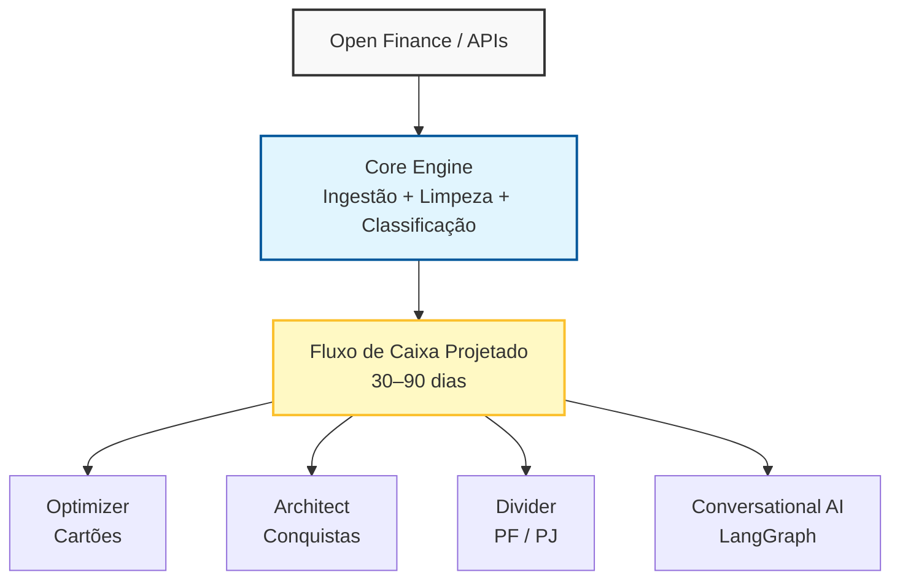

# 🏦 Nexa AI — The Autonomous Financial Agent

> **Status:** MVP em Desenvolvimento 🚧  
> **Missão:** Democratizar a inteligência financeira de *Family Offices* para o brasileiro comum usando **IA Generativa + Matemática Determinística**.

A **Nexa AI** não é um organizador financeiro passivo.  
Ela é um **Agente Financeiro Autônomo** que:
- **Prevê o futuro** (Fluxo de Caixa, compromissos e riscos)
- **Otimiza o presente** (cartões, taxas, decisões de gasto)
- **Conversa naturalmente** com o usuário, explicando *o porquê* de cada decisão

> Pense na Nexa como um **GPS financeiro**: ela sabe onde você está, para onde vai e qual o caminho matematicamente mais inteligente.

---

## 🧠 Visão Geral do Sistema

A Nexa é composta por **módulos independentes**, todos sustentados por um **Core Engine unificado**, que garante consistência de dados, explicabilidade e segurança.

---

## 📚 Documentação Técnica (Engineering Specs)

A documentação está organizada **por funcionalidade**.  
⚠️ **IMPORTANTE:** o time deve seguir a ordem abaixo, pois cada módulo depende do anterior.

---

## 1️⃣ Core Engine & Ingestão — *Funcionalidade 1*

> **O coração da Nexa**

### 🎯 Objetivo
Criar uma visão **confiável, limpa e projetada** da vida financeira do usuário.

### 🔍 Responsabilidades
- Ingestão de dados via **Open Finance**
- Normalização e limpeza com **Polars**
- Classificação inicial de transações (Waterfall + ML)
- Projeção determinística e probabilística do fluxo de caixa
- Interface conversacional base (Chat)

### 🧠 Conceitos-chave
- **Transactions Clean:** dado financeiro confiável
- **Shadow Invoice:** parcelas e assinaturas detectadas automaticamente
- **Safe-to-Spend:** quanto o usuário pode gastar hoje sem risco
- **Daily Forecast:** saldo projetado dia a dia

### 🧱 Stack
- **Data Processing:** Polars (Rust)
- **ML (Classificação):** CatBoost
- **Forecast:** NeuralProphet + lógica determinística
- **Agent Orchestration:** LangGraph

📄 *Docs detalhados:* `/docs/funcionalidade-1-core-engine.md`

---

## 2️⃣ Nexa Optimizer — Otimizador de Crédito (*Funcionalidade 2*)

> **Matemática fria, zero marketing**

### 🎯 Objetivo
Recomendar **cartões de crédito** que realmente maximizam retorno líquido para o usuário.

### 🧠 Premissa
A Nexa **não recomenda troca** se não houver ganho matemático real.

### 🔍 O que o sistema analisa
- Gasto projetado futuro (não só histórico)
- Mix de categorias (mercado, viagem, internacional)
- Parcelas futuras e impacto de liquidez
- Anuidade real (considerando isenções)
- Conversão de pontos → R$

### 📊 Saída
- Faixa de ganho: pessimista / esperado / otimista
- Impacto no caixa
- Score de confiança
- Explicação passo a passo

### 🧱 Stack
- Scikit-learn
- Rule-based Engine
- Polars
- LangGraph (explicabilidade)

📄 *Docs detalhados:* `/docs/funcionalidade-2-optimizer.md`

---

## 3️⃣ Nexa Architect — Simulador de Conquistas (*Funcionalidade 3*)

> **O fim da taxa de juros como dogma**

### 🎯 Objetivo
Simular a forma **mais barata no tempo** para adquirir bens de alto valor:
- Carro
- Imóvel
- Grandes metas financeiras

### 🧠 Premissa Central
**Urgência (tempo)** × **Custo Total (dinheiro)**

### ⚙️ Estratégias Comparadas
- Financiamento (SAC / Price)
- Consórcio Estratégico (Monte Carlo + probabilidade de lance)

### 📊 Métrica de decisão
- Valor Presente Líquido (VPL)
- Risco de liquidez
- Probabilidade de sucesso

### 🧱 Stack
- NumPy
- Monte Carlo Simulation
- Scikit-learn
- APIs econômicas (taxas, Selic, consórcios)

📄 *Docs detalhados:* `/docs/funcionalidade-3-architect.md`

---

## 4️⃣ Nexa Divider — Separação PF / PJ (*Funcionalidade 4*)

> **Contexto > Categoria**

### 🎯 Objetivo
Separar automaticamente **despesas pessoais (PF)** de **despesas operacionais (PJ)**, mesmo quando tudo passa pela mesma conta.

### 🧠 Premissa Central
**Contexto temporal + semântico + comportamental**

> Um almoço terça 12h perto do escritório ≠ almoço domingo 14h.

### 🔍 O que o modelo analisa
- Horário e dia da semana
- Localização (clusters casa / trabalho)
- Tipo de conta
- Histórico comportamental
- Correções manuais do usuário (Active Learning)

### 🧠 Modelo
- Random Forest (MVP)
- Regras de prioridade (antes do ML)
- Aprendizado contínuo com feedback

### 🧱 Stack
- Polars
- Scikit-learn
- FastAPI
- MLflow

📄 *Docs detalhados:* `/docs/funcionalidade-4-divider.md`

---

## 🛠️ Tech Stack Principal

| Área | Tecnologia | Motivo |
|-----|-----------|-------|
| Backend | Python 3.11+ | Ecossistema maduro de IA |
| Data Processing | Polars (Rust) | Performance extrema em ETL financeiro |
| ML Tabular | CatBoost | Alta performance com pouco tuning |
| Time Series | NeuralProphet | Previsão com explicabilidade |
| Agent Orchestration | LangGraph | Controle de estado e loops complexos |
| Database | PostgreSQL | Segurança e consistência |
| Observability | OpenTelemetry | Auditoria e confiabilidade |
| ML Tracking | MLflow | Versionamento de modelos |

---

## 🧩 Filosofia da Nexa

- **Nada de caixa-preta** → Toda decisão é explicável
- **Sem achismo** → Apenas matemática e dados projetados
- **IA como copiloto** → O usuário sempre pode corrigir
- **Primeiro segurança, depois otimização**

---

## 🚀 Roadmap (Resumo)

**MVP**
- Core Engine + Forecast
- Optimizer básico
- Divider com aprendizado manual

**v1**
- Architect completo
- Active Learning automático
- UI de revisão inteligente

**v2**
- Estratégias fiscais
- Integração com contadores
- Planejamento patrimonial avançado

---

## 👥 Nexa AI Engineering Team

© 2026 — Nexa AI  
Construindo o **primeiro Agente Financeiro Autônomo do Brasil**.
